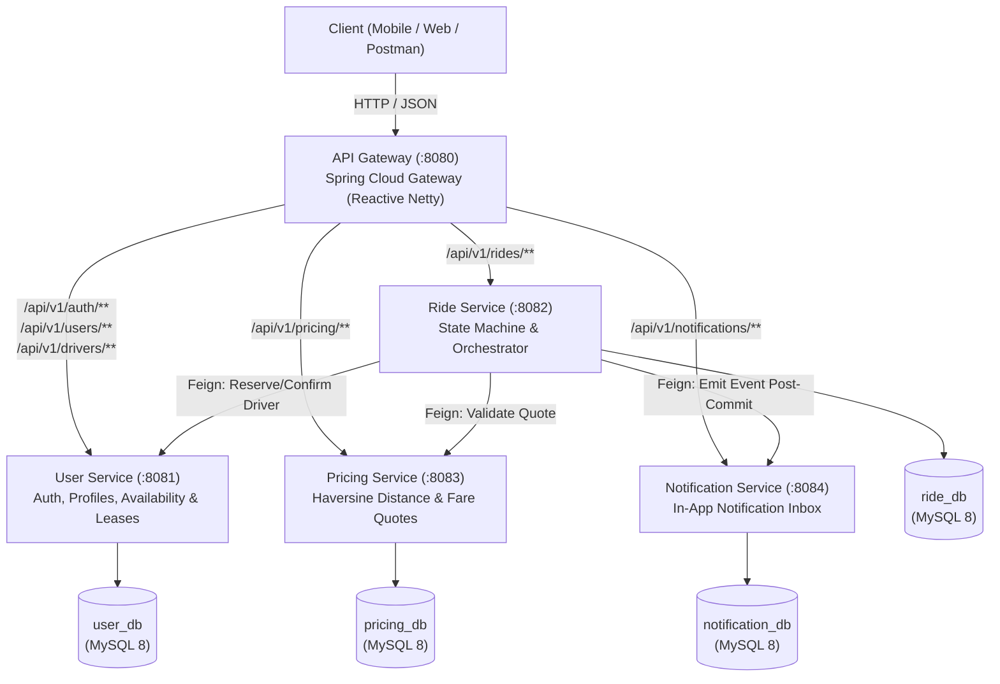

# Ride Sharing Platform Backend

A distributed, enterprise-grade ride-sharing platform backend built with **Java 21**, **Spring Boot 4.1.1**, **Spring Cloud 2025.1.3 (Oakwood)**, **MySQL 8**, and **Spring Cloud Gateway (WebFlux / Netty)**.

The platform simulates the core ride lifecycle: passenger and driver authentication, geospatial driver discovery via the Haversine formula, dynamic fare quote generation with HMAC-SHA256 tamper-proof tokens, a non-blocking distributed driver lease protocol, ride state machine transitions with optimistic concurrency locking, and event-driven in-app notifications.

---

## 1. System Architecture & Request Flow

All client traffic enters the system through a single reactive **API Gateway** on port `8080`. Downstream microservices are decoupled, maintain independent database schemas, and communicate internally via Spring Cloud OpenFeign.



### Gateway Filter Pipeline (Executed in Strict Order)
1. **`UntrustedHeaderStrippingFilter` (Order -100)**: Strips external caller-supplied `X-User-*` and `X-Service-Name` headers before proxying.
2. **`PathSanitizationGlobalFilter` (Order -95)**: Intercepts percent-encoding exploits (`%2F`, `%5C`), directory traversal (`/../`, `/./`), double-encoding (`%25`), duplicate slashes, and null bytes.
3. **`InternalEndpointBlockFilter` (Order -90)**: Blocks public access to `/internal/**`, driver operational RPC routes (`/reserve`, `/confirm-ride`, `/release-reservation`, `/complete-ride`), and quote snapshots with `403 Forbidden`.
4. **`StreamingRequestSizeGlobalFilter` (Order -85)**:
   - Enforces a **2 MiB (2,097,152 bytes) payload ceiling**.
   - **Admission Control**: Caps chunked requests at 50 global and 10 per-client IP streams, returning `429 Too Many Requests` before allocating body buffers.
   - **Upload Deadline**: Enforces a genuine 10-second total upload deadline, aborting slowloris trickle uploads with `408 Request Timeout`.
   - **Framing Normalization**: Sets `Content-Length` and strips `Transfer-Encoding: chunked` before routing downstream.
   - **Zero Buffer Leaks**: Guaranteed exact-once release of Netty pooled `DataBuffer`s on success, error, timeout, and cancellation.
5. **`AuthRateLimiterFilter` (Order -60)**: Enforces 20 req/min sliding-window rate limit on public `/api/v1/auth/register` and `/login`. Uses right-to-left `X-Forwarded-For` parsing only when direct peer is in `trusted-proxies`.
6. **`GatewayAuthenticationFilter` (Order -50)**: Validates edge JWT signatures; rejects `ROLE_INTERNAL_SERVICE` from external callers; allows public `/api/v1/auth/**`, `/actuator/health`, and `/actuator/info`.

---

## 2. Modules & Responsibilities

| Module | HTTP Port | Context Path | Primary Responsibilities |
|:---|:---:|:---|:---|
| **`api-gateway`** | `8080` | `/` | Reverse proxy, path sanitization, internal endpoint blocking, 2 MiB request size limit, upload deadline (408), admission control (429), auth rate limiting (429), and edge JWT verification. |
| **`user-service`** | `8081` | `/api/v1/auth`<br/>`/api/v1/users`<br/>`/api/v1/drivers` | User & driver registration, BCrypt password hashing (strength 12), JWT token issuance, driver availability toggle, Haversine geospatial proximity discovery, and 30s TTL distributed driver reservation leases. |
| **`pricing-service`** | `8083` | `/api/v1/pricing` | Spherical Haversine distance calculation, dynamic fare estimation (`baseFare + distanceFare + bookingFee`), and 10-minute expiring HMAC quote tokens (`GET /quotes/{quoteToken}` restricted to `ROLE_INTERNAL_SERVICE`). |
| **`ride-service`** | `8082` | `/api/v1/rides` | Core state machine orchestrator (`REQUESTED` $\rightarrow$ `ACCEPTED` $\rightarrow$ `DRIVER_ARRIVING` $\rightarrow$ `IN_PROGRESS` $\rightarrow$ `COMPLETED` / `CANCELLED`), 4-phase distributed lease acceptance, optimistic concurrency locking (`@Version`), compensation rollback, and Feign RPC clients. |
| **`notification-service`** | `8084` | `/api/v1/notifications` | Asynchronous in-app notification inbox, tenant isolation (queries strictly scoped to caller's user ID), and idempotency key uniqueness backed by database constraints. |
| **`system-integration-tests`** | Ephemeral | N/A | Dedicated test harness (`SystemIntegrationCluster`) launching all 5 services and gateway on dynamic ports with isolated in-memory H2 databases for complete end-to-end integration verification. |

---

## 3. Payment & Billing Scope (MVP Architecture Boundary)

The platform is designed to model core ride-sharing state machine transitions, distributed driver leasing, geospatial discovery, and pricing quotes with zero-row rollback guarantees.

In accordance with [`docs/requirements.md`](docs/requirements.md#4-explicitly-out-of-scope-mvp-exclusions), **real third-party payment processing (e.g., Stripe, Razorpay) and banking/wallet transfers are intentionally excluded from the MVP scope.**

### Fare Calculation vs. Financial Settlement
- **Fare Estimation**: `pricing-service` calculates dynamic distance and base fare quotes, returning a tamper-proof HMAC quote token.
- **Ride Creation**: `ride-service` verifies the quote token and freezes the fare snapshot (`baseFare`, `distanceFare`, `bookingFee`, `estimatedFare`, `currency`).
- **Ride Completion**: When an assigned driver completes a ride via `POST /api/v1/rides/{rideId}/complete`, the service records `final_fare` equal to `estimated_fare` and transitions the ride to terminal status `COMPLETED`.
- **No Transaction Created**: Completing a ride **does not create a payment transaction, capture credit cards, or prove that money was collected**. Payment status tracking (e.g., `PENDING_PAYMENT`, `SETTLED`) and automated payment gateway webhooks are reserved for a future payment microservice.

---

## 4. Prerequisites & Environment Variables

### Prerequisites
- **Java**: Java 21 JDK (Eclipse Temurin or OpenJDK 21)
- **Build Tool**: Maven 3.9+ (or included Maven Wrapper `./mvnw` / `mvnw.cmd`)
- **Database**: MySQL 8.0+ (for persistent production/local runs) or H2 (used automatically in tests)

### Environment Variable Reference

| Variable Name | Required In | Description & Format | Default / Fallback |
|:---|:---:|:---|:---|
| `JWT_SECRET` | **Production** | 256-bit (minimum 32-byte) secret for signing and validating client JWTs and inter-service Feign tokens (`ROLE_INTERNAL_SERVICE`). **Strictly required with no fallback in production.** | None in production (test secret used in test profiles). |
| `SPRING_DATASOURCE_URL` | Optional | Full JDBC URL (e.g. `jdbc:mysql://localhost:3306/user_db?serverTimezone=UTC`). | Constructs from `DB_HOST`/`DB_PORT`/`DB_NAME`. |
| `SPRING_DATASOURCE_USERNAME` | Production | Database username. | Falls back to `DB_USERNAME`. |
| `SPRING_DATASOURCE_PASSWORD` | Production | Database password. | Falls back to `DB_PASSWORD`. |
| `DB_HOST` | Development | Database host (used if `SPRING_DATASOURCE_URL` is unset). | `localhost` |
| `DB_PORT` | Development | Database port. | `3306` |
| `DB_NAME` | Development | Logical database name (`user_db`, `pricing_db`, etc.). | Service-specific default |
| `USER_SERVICE_URL` | Optional | Gateway / Feign target for User Service. | `http://localhost:8081` |
| `RIDE_SERVICE_URL` | Optional | Gateway target for Ride Service. | `http://localhost:8082` |
| `PRICING_SERVICE_URL` | Optional | Gateway / Feign target for Pricing Service. | `http://localhost:8083` |
| `NOTIFICATION_SERVICE_URL` | Optional | Gateway / Feign target for Notification Service. | `http://localhost:8084` |
| `GATEWAY_TRUSTED_PROXIES` | Optional | Comma-separated list of trusted upstream reverse proxy IPs allowed to supply `X-Forwarded-For`. | `127.0.0.1, ::1, 0:0:0:0:0:0:0:1` |

#### Production Secret Hardening (`JWT_SECRET`)
While the local Docker Compose configuration includes a development fallback for zero-configuration developer onboarding, staging and production deployments **must explicitly configure an external `JWT_SECRET`**:
- **Strictly Required in Production**: In standalone service runtime profiles, omitting `JWT_SECRET` causes startup failure, preventing containers or services from running with insecure fallback keys.
- **Key Generation**: Generate a cryptographically secure 256-bit (32-byte) key using standard tools without hardcoding or committing it to source control:
  ```bash
  # Linux / macOS (OpenSSL)
  export JWT_SECRET=$(openssl rand -hex 32)

  # Windows (PowerShell 5.1 & PowerShell 7+)
  $bytes = New-Object byte[] 32
  [System.Security.Cryptography.RandomNumberGenerator]::Create().GetBytes($bytes)
  $env:JWT_SECRET = ([System.BitConverter]::ToString($bytes) -replace '-').ToLower()
  ```
- **Secrets Management**: In cloud or containerized production environments, inject `JWT_SECRET` via a dedicated secrets vault (e.g., AWS Secrets Manager, HashiCorp Vault, Kubernetes Secrets) rather than commiting `.env` files into source control.

#### Datasource Precedence Rule (`user-service`)
`user-service` supports standard Spring Boot datasource properties with backward-compatible fallbacks:
1. `SPRING_DATASOURCE_URL` takes primary precedence. If absent, falls back to `jdbc:mysql://${DB_HOST:localhost}:${DB_PORT:3306}/${DB_NAME:user_db}`.
2. `SPRING_DATASOURCE_USERNAME` takes primary precedence. If absent, falls back to `DB_USERNAME`.
3. `SPRING_DATASOURCE_PASSWORD` takes primary precedence. If absent, falls back to `DB_PASSWORD`.

#### Inter-Service RPC Security & Future Key Separation
Currently, `ride-service` (`InternalTokenService`) generates internal service JWTs carrying claim `role: ROLE_INTERNAL_SERVICE` signed with `JWT_SECRET`. Downstream services (`user-service`, `pricing-service`, `notification-service`) validate these tokens using `JWT_SECRET`. Edge isolation is maintained by the API Gateway:
- `UntrustedHeaderStrippingFilter` removes caller-supplied identity headers.
- `GatewayAuthenticationFilter` rejects external requests presenting `ROLE_INTERNAL_SERVICE`.
- `InternalEndpointBlockFilter` blocks external access to internal endpoints (`/internal/**`).

> [!NOTE]
> An independent `INTERNAL_RPC_SECRET` is **not** currently implemented in the codebase; both user JWTs and inter-service tokens share `JWT_SECRET`. Decoupling inter-service signing keys from user JWT keys is recognized as a recommended future security improvement for post-Phase 1 hardening.

---

## 5. Build & Test Commands (Verified Offline)

All automated tests execute against isolated, in-memory H2 databases (`MODE=MySQL`) and mock servers. **Zero external database connections or external network dependencies are required to build and test.**

### Run Full Maven Reactor Test Suite
```powershell
# Windows (PowerShell)
.\mvnw.cmd test

# Linux / macOS
./mvnw test
```
*Current Verified Status: 7 projects, 325 tests, 0 failures, 0 errors, 0 skips.*

### Run Module-Specific Test Suites
```powershell
# API Gateway resilience, rate limiting, and streaming size tests (76 tests)
.\mvnw.cmd test -pl api-gateway

# User Service auth, driver availability, lease protocol & health tests (84 tests)
.\mvnw.cmd test -pl user-service

# Pricing Service fare calculation, quotes & health tests (33 tests)
.\mvnw.cmd test -pl pricing-service

# Ride Service state machine, compensation & health tests (83 tests)
.\mvnw.cmd test -pl ride-service

# Notification Service inbox, idempotency & health tests (30 tests)
.\mvnw.cmd test -pl notification-service

# Full End-to-End ride lifecycle multi-service integration tests (19 tests)
.\mvnw.cmd test -pl system-integration-tests
```

### Clean Build Without Tests
```powershell
.\mvnw.cmd clean package -DskipTests
```

---

## 6. Database Setup & Migrations Overview

The platform adheres to strict **schema isolation**: each microservice manages its own logical database schema. Cross-database foreign keys and joins are strictly prohibited. References between services are stored as logical IDs (`passenger_id`, `driver_id`, `reference_ride_id`).

### Database Schemas
- `user_db`: Managed by `user-service` (`V1__init_user_schema.sql`, `V2__add_driver_location_timestamp.sql`)
- `pricing_db`: Managed by `pricing-service` (`V1__init_pricing_schema.sql`)
- `ride_db`: Managed by `ride-service` (`V1__init_ride_schema.sql`)
- `notification_db`: Managed by `notification-service` (`V1__init_notification_schema.sql`)

### Initialization Script
When setting up a local or production MySQL 8 instance, run `docs/init-databases.sql` to create the four empty database schemas before starting the services:
```sql
CREATE DATABASE IF NOT EXISTS user_db CHARACTER SET utf8mb4 COLLATE utf8mb4_unicode_ci;
CREATE DATABASE IF NOT EXISTS pricing_db CHARACTER SET utf8mb4 COLLATE utf8mb4_unicode_ci;
CREATE DATABASE IF NOT EXISTS ride_db CHARACTER SET utf8mb4 COLLATE utf8mb4_unicode_ci;
CREATE DATABASE IF NOT EXISTS notification_db CHARACTER SET utf8mb4 COLLATE utf8mb4_unicode_ci;
```
Upon service startup, Flyway automatically applies all pending migrations and Hibernate validates the entity mappings (`spring.jpa.hibernate.ddl-auto=validate`).

---

## 7. Execution Status: Verified vs. Unverified Workflows

To ensure technical transparency, execution commands are categorized by their verification status:

### Verified Workflows (Confirmed Working via Automated Tests & Offline Audit)
- `.\mvnw.cmd test` compiles and passes all **325 unit, slice, and integration tests** across all 7 projects.
- In-memory H2 databases run with zero host port 3306 contact (`Get-NetTCPConnection -RemotePort 3306` confirms 0 connections).
- `system-integration-tests` launches all 5 backend services and the API Gateway on ephemeral ports, successfully verifying the entire 18-step ride lifecycle and security negative tests.
- Streaming chunked request protection rejects oversized payloads (> 2 MiB) with HTTP 413 and slowloris trickle uploads (> 10s) with HTTP 408 before downstream invocation.
- Spring Boot 4.1.1 layered JAR extraction toolchain verified offline (`-Djarmode=tools ... extract --layers --launcher --destination <dir>`) with launcher `org.springframework.boot.loader.launch.JarLauncher`.
- Production-grade multi-stage Dockerfiles and root `docker-compose.yml` authored with strict isolation (MySQL on host port 3307, unprivileged non-root users, readiness health checks, and private service networking).

### Operational / Environment Prerequisites (Scheduled for Milestone 8 Phase 3+)
- **Live Docker Execution**: Running `docker compose up --build` requires the Docker Engine / Desktop daemon installed on the host.
- **Physical MySQL 8 Flyway Migrations**: While Flyway migration scripts are validated against in-memory H2 and DDL syntax is verified, executing live migrations against the isolated Docker MySQL container (port 3307) will occur once the Docker daemon is available.
- **Production Secret Deployment**: Production secret generation and externalized key-management vaults are operational deployment tasks.

---

## 8. Containerization & Docker Compose Stack (Milestone 8 — Phase 2B)

The platform provides a production-grade containerization stack orchestrating MySQL 8 and all five microservices.

### Container Architecture & Security Boundaries
- **Host Port Isolation**: Host MySQL (default port 3306) is completely untouched. The Docker MySQL container binds to host port `3307:3306`.
- **Edge Routing & Ingress**: Only `api-gateway` exposes port `8080:8080` to the host. Downstream microservices (`user-service:8081`, `ride-service:8082`, `pricing-service:8083`, `notification-service:8084`) have no host port bindings and communicate strictly over the internal bridge network `rideshare-network`.
- **Least Privilege (Non-Root)**: All service runtime containers run under an unprivileged system user (`appuser:appgroup`, UID/GID non-root) with `/sbin/nologin`.
- **Layered JAR Packaging**: Multi-stage Dockerfiles utilize Spring Boot 4.1.1's `-Djarmode=tools` layer extraction, optimizing container image caching across dependencies, loader, snapshots, and application code.
- **Production Secret Injection**: While Compose defines a development fallback for local developer ergonomics, staging and production deployments must explicitly export `JWT_SECRET` in the host environment prior to launching containers (`export JWT_SECRET=...`).
- **Health Checks & Startup Sequencing**: Every service container defines a native Docker `HEALTHCHECK` querying `/actuator/health/readiness`. Startup dependencies enforce `condition: service_healthy`:
  - `mysql` initializes schemas via `docs/init-databases.sql`.
  - `user-service`, `pricing-service`, and `notification-service` wait for `mysql` healthy.
  - `ride-service` waits for `mysql`, `user-service`, `pricing-service`, and `notification-service` healthy.
  - `api-gateway` waits for all four downstream services healthy before accepting traffic.

### Local Container Commands (When Docker Engine is Available)
```bash
# Start the full stack (MySQL on 3307 + 5 services + API Gateway on 8080)
docker compose up --build -d

# Follow container startup logs
docker compose logs -f

# Check health check status across all containers
docker compose ps

# Shut down the stack preserving persistent database volumes
docker compose down

# Shut down and wipe database volumes (clean reset)
docker compose down -v
```

---

## 9. Documentation Directory

For detailed architectural specifications, state machine definitions, and schema designs, refer to the documentation in `/docs`:
- [Architecture Documentation](docs/architecture.md) — Component diagrams, Feign RPC flows, and sequence diagrams
- [REST API Specification](docs/api-specification.md) — Endpoint contracts, request/response JSON schemas, and error codes
- [Database Design & Schema Management](docs/database-design.md) — Entity-relationship diagrams, schema isolation, and indexing strategy
- [Ride Lifecycle & Concurrency Protocol](docs/ride-lifecycle.md) — State machine transitions, 4-phase lease protocol, and rollback compensation
- [Requirements & MVP Scope](docs/requirements.md) — Product specifications, actor roles, and out-of-scope boundaries
- [Milestone Implementation Tracker](docs/milestone-tracker.md) — Live milestone audit records, test reconciliation, and historical delivery logs
