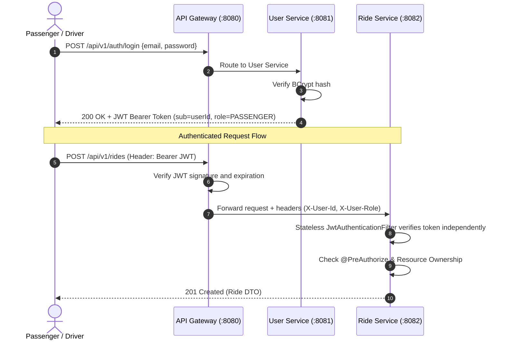

# System Architecture Documentation
## Ride Sharing Platform Backend

---

## 1. System Overview

The system is structured as a **distributed microservices architecture** orchestrated via a single **Spring Cloud Gateway** on port 8080. Each microservice owns its business logic and isolated MySQL 8 schema.

```mermaid
flowchart TD
    Client["Client / Postman / Swagger UI"] -->|HTTP / JSON| Gateway["API Gateway (:8080)\nSpring Cloud Gateway (Reactive)"]

    Gateway -->|/api/v1/auth/**\n/api/v1/users/**\n/api/v1/drivers/**| UserService["User Service (:8081)\nAuth, Profiles, Availability"]
    Gateway -->|/api/v1/rides/**| RideService["Ride Service (:8082)\nCore Orchestrator & State Machine"]
    Gateway -->|/api/v1/pricing/**| PricingService["Pricing Service (:8083)\nFare Quotes & Haversine Distance"]
    Gateway -->|/api/v1/notifications/**| NotificationService["Notification Service (:8084)\nIn-App Event Persistence"]

    RideService -->|Feign: Validate Quote| PricingService
    RideService -->|Feign: Reserve/Confirm Driver| UserService
    RideService -->|Feign: Emit Event (Best-Effort)| NotificationService

    UserService --> DB1[("user_db\n(MySQL 8)")]
    RideService --> DB2[("ride_db\n(MySQL 8)")]
    PricingService --> DB3[("pricing_db\n(MySQL 8)")]
    NotificationService --> DB4[("notification_db\n(MySQL 8)")]
```

---

## 2. Component Directory & Network Mapping

| Module Name | HTTP Port | Context Root | Database Schema | Primary Responsibility |
| :--- | :--- | :--- | :--- | :--- |
| **`api-gateway`** | `8080` | `/` | *None* | Reverse proxy, global CORS, edge JWT signature check, routing. |
| **`user-service`** | `8081` | `/api/v1/auth`, `/api/v1/users`, `/api/v1/drivers` | `user_db` | User accounts, driver profiles, BCrypt hashing, JWT issuance, driver lease management. |
| **`ride-service`** | `8082` | `/api/v1/rides` | `ride_db` | Central business orchestrator, ride lifecycle state transitions, driver matching. |
| **`pricing-service`** | `8083` | `/api/v1/pricing` | `pricing_db` | Haversine distance computation, fare quote token creation, final fare calculation. |
| **`notification-service`** | `8084` | `/api/v1/notifications` | `notification_db` | Persisted in-app event logging, mark-as-read tracking. |

---

## 3. Inter-Service Communication Patterns (OpenFeign)

1. **Ride Creation Call Flow**:
   - `Ride Service` $\rightarrow$ calls `Pricing Service` (`GET /api/v1/pricing/quotes/{quoteToken}`) to verify quote validity and lock in the estimated fare snapshot.
2. **Driver Assignment Call Flow**:
   - `Ride Service` $\rightarrow$ calls `User Service` (`GET /api/v1/drivers/available?lat=...&lng=...`) to discover eligible online drivers.
   - `Ride Service` $\rightarrow$ calls `User Service` (`POST /api/v1/drivers/{id}/reserve`) to acquire a 30-second TTL lease.
   - `Ride Service` $\rightarrow$ calls `User Service` (`POST /api/v1/drivers/{id}/confirm-ride`) upon committing local ride assignment.
3. **Event Notification Call Flow**:
   - `Ride Service` $\rightarrow$ calls `Notification Service` (`POST /api/v1/notifications`) upon state transitions.
   - *Resilience Guarantee*: The notification call uses an OpenFeign error decoder fallback (best-effort delivery). If `Notification Service` is temporarily down, the completed ride transaction commits independently, and a warning is logged.

---

## 4. Security Architecture



- **Algorithm**: `HMAC-SHA256` (`HS256`) using a 256-bit secret loaded from environment `JWT_SECRET`.
- **Claims Payload**:
  - `sub`: Numeric user ID string.
  - `email`: User email address.
  - `role`: Role string (`ROLE_PASSENGER`, `ROLE_DRIVER`, `ROLE_ADMIN`).
  - `iat` and `exp`: 24-hour expiration token lifetime for MVP.
- **Defense in Depth**: Downstream business services do not blindly trust headers forwarded by the gateway; each service includes a lightweight `JwtAuthenticationFilter` that independently parses the bearer token, establishes the `SecurityContext`, and enforces resource ownership.
