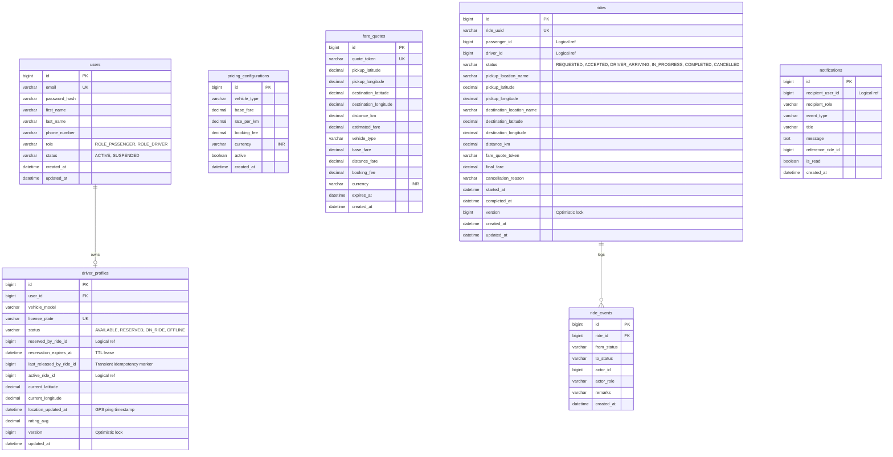

# Database Design & Schema Management
## Ride Sharing Platform Backend

---

## 1. Schema Isolation Principle
Each microservice maintains exclusive ownership over an independent MySQL 8 database schema on the local instance (`localhost:3306`).
- **No Cross-Service SQL Queries**: Microservices communicate only through HTTP REST / OpenFeign APIs.
- **No Shared Tables or Cross-Database Foreign Keys**: References across databases are stored as logical IDs (`passenger_id`, `driver_id`, `reference_ride_id`).
- **Managed Migrations**: Schema changes are managed strictly via Flyway (`src/main/resources/db/migration/V1__*.sql`). Hibernate is set to `spring.jpa.hibernate.ddl-auto=validate`.

---

## 2. Entity Relationship Overview

---

## 3. Critical Indexes & Performance Optimizations

1. **`user_db.users`**:
   - `UNIQUE INDEX idx_users_email (email)`: Enforces uniqueness on email addresses.
2. **`user_db.driver_profiles`**:
   - `UNIQUE INDEX idx_driver_license (license_plate)`: Enforces uniqueness on license plates.
   - `INDEX idx_driver_status_lookup (status, reservation_expires_at)`: Accelerates finding available drivers and evaluating expired leases.
3. **`pricing_db.fare_quotes`**:
   - `UNIQUE INDEX idx_quote_token (quote_token)`: Quick lookup for validating quote tokens.
   - `INDEX idx_quote_expires_at (expires_at)`: Accelerates expiration purge.
4. **`ride_db.rides`**:
   - `UNIQUE INDEX idx_rides_uuid (ride_uuid)`: External public identifier for ride queries.
   - `INDEX idx_rides_passenger (passenger_id, created_at DESC)`: Rapid retrieval of passenger ride history.
   - `INDEX idx_rides_driver (driver_id, status)`: Ensures fast checking of driver active rides.
5. **`notification_db.notifications`**:
   - `INDEX idx_notif_recipient (recipient_user_id, is_read, created_at DESC)`: Optimizes user in-app notification queries.
