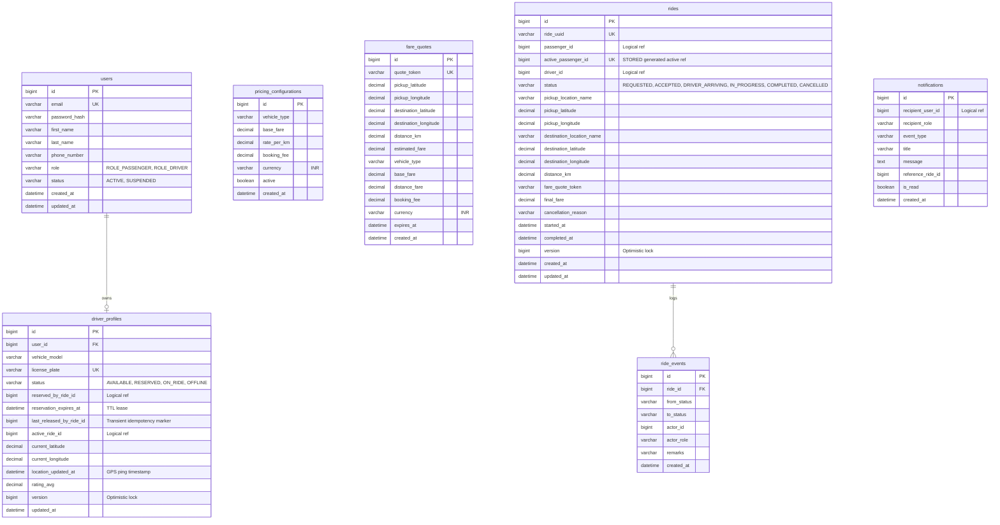

# Database Design & Schema Management
## Ride Sharing Platform Backend

---

## 1. Schema Isolation Principle
Each microservice maintains exclusive ownership over an independent MySQL 8 database schema on the local instance (`localhost:3306`).
- **No Cross-Service SQL Queries**: Microservices communicate only through HTTP REST / OpenFeign APIs.
- **No Shared Tables or Cross-Database Foreign Keys**: References across databases are stored as logical IDs (`passenger_id`, `driver_id`, `reference_ride_id`).
- **Managed Migrations**: Schema changes are managed strictly via Flyway (`src/main/resources/db/migration/V*__*.sql`). Hibernate is set to `spring.jpa.hibernate.ddl-auto=validate`.

---

## 2. Entity Relationship Overview



---

## 3. Critical Indexes & Performance Optimizations

1. **`user_db.users`**:
   - `UNIQUE INDEX idx_users_email (email)`: Enforces uniqueness on email addresses.
2. **`user_db.driver_profiles`**:
   - `UNIQUE INDEX idx_driver_license (license_plate)`: Enforces uniqueness on license plates.
   - `INDEX idx_driver_status_lookup (status, reservation_expires_at)`: Accelerates finding available drivers and evaluating expired leases.
3. **`pricing_db.fare_quotes`**:
   - `UNIQUE INDEX idx_quote_token (quote_token)`: Quick lookup for validating quote tokens.
   - `INDEX idx_quote_expires_at (expires_at)`: Accelerates expiration purge.
4. **`ride_db.rides`**:
   - `UNIQUE INDEX idx_rides_uuid (ride_uuid)`: External public identifier for ride queries.
   - `UNIQUE INDEX uq_rides_active_passenger (active_passenger_id)`: Enforces at most one active ride per passenger at the database engine level.
   - `INDEX idx_rides_passenger (passenger_id, created_at DESC)`: Rapid retrieval of passenger ride history.
   - `INDEX idx_rides_driver (driver_id, status)`: Ensures fast checking of driver active rides.
5. **`notification_db.notifications`**:
   - `INDEX idx_notif_recipient (recipient_user_id, is_read, created_at DESC)`: Optimizes user in-app notification queries.

---

## 4. Single Active Ride Per Passenger (MySQL 8 STORED Generated Column)

To enforce that a passenger can have at most one concurrent active ride across the platform without relying on distributed locks or race-prone application-level pre-checks, `ride_db.rides` uses a **MySQL 8.0 `STORED` generated column** paired with a **unique constraint** (`V2__enforce_single_active_ride_per_passenger.sql`).

### Column Definition & CASE Expression:
```sql
ALTER TABLE rides
    ADD COLUMN active_passenger_id BIGINT
        GENERATED ALWAYS AS (
            CASE
                WHEN status IN ('REQUESTED', 'ACCEPTED', 'DRIVER_ARRIVING', 'IN_PROGRESS') THEN passenger_id
                ELSE NULL
            END
        ) STORED
        AFTER passenger_id;

ALTER TABLE rides
    ADD CONSTRAINT uq_rides_active_passenger UNIQUE (active_passenger_id);
```

### Invariant & Lifecycle Constraint Behavior:
1. **Active Ride Enforcement**:
   - For all active ride lifecycle statuses (`REQUESTED`, `ACCEPTED`, `DRIVER_ARRIVING`, `IN_PROGRESS`), the `CASE` expression evaluates to `passenger_id`.
   - The unique constraint `uq_rides_active_passenger` guarantees that no two rows can share the same non-null `active_passenger_id`.
   - If a passenger with an existing active ride attempts to book another ride, MySQL immediately raises a `1062 Duplicate entry ... for key 'rides.uq_rides_active_passenger'` error, which `RideServiceImpl` intercepts and translates into an RFC 7807 HTTP 409 `ConflictException`.
2. **Atomic Constraint Release on Terminal Statuses**:
   - In accordance with the SQL standard and MySQL InnoDB semantics, unique indexes allow multiple `NULL` values.
   - When a ride reaches a terminal status (`COMPLETED` or `CANCELLED`), the `CASE` expression automatically evaluates to `NULL`.
   - This atomically and immediately releases the unique constraint for that passenger within the same database transaction, allowing the passenger to request their next ride without manual cleanup or secondary table deletion.
3. **Storage & Materialization (`STORED` vs `VIRTUAL`)**:
   - The column is defined as `STORED` rather than `VIRTUAL`. MySQL computes and stores the value on row insert and status update, persisting it directly in the table data and supporting standard B-tree index lookups without runtime expression evaluation during reads.
