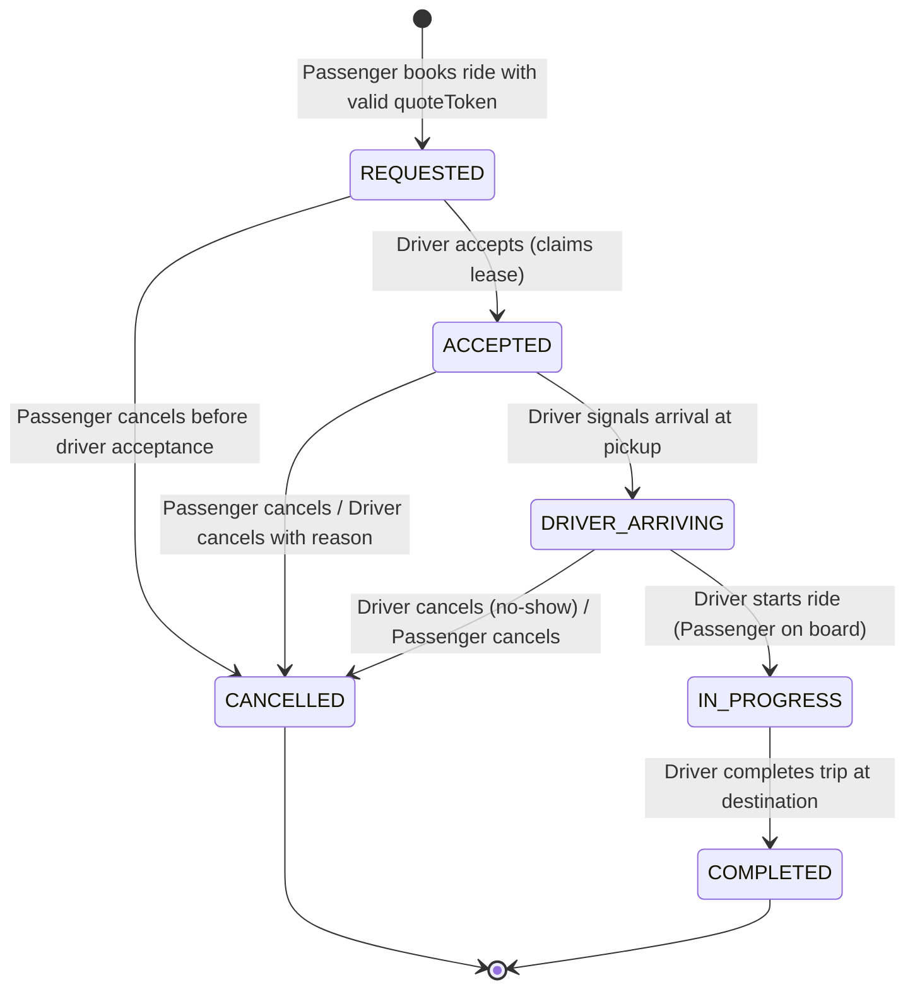
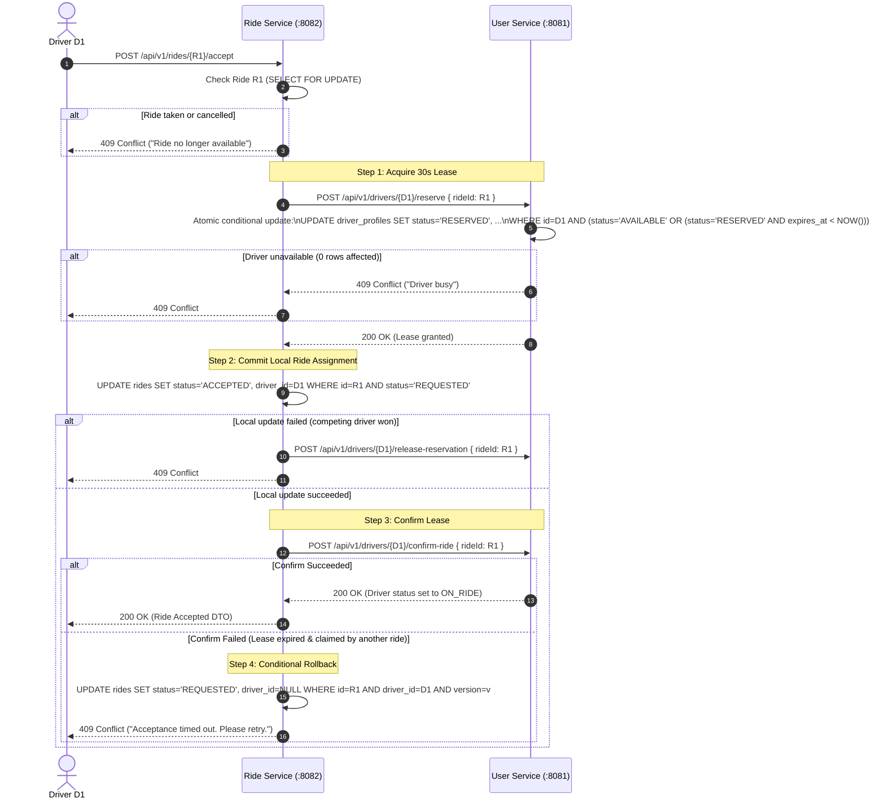

# Ride Lifecycle & Distributed Concurrency Architecture
## State Machine, Lease Protocol & Zero-Row Rollback Recovery

---

## 1. Ride State Machine



### Invariants:
1. **Terminal States**: `COMPLETED` and `CANCELLED` are immutable and cannot transition to any other state.
2. **Actor Enforcement**:
   - Only `PASSENGER` (owner) can create a ride or cancel while `REQUESTED`.
   - Only the assigned `DRIVER` can advance `ACCEPTED` $\rightarrow$ `DRIVER_ARRIVING` $\rightarrow$ `IN_PROGRESS` $\rightarrow$ `COMPLETED`.
   - Either actor can cancel in valid pre-trip states (`ACCEPTED`, `DRIVER_ARRIVING`).

---

## 2. Distributed Driver Reservation Protocol

To bridge `ride_db` and `user_db` without 2PC/XA, the system uses a **two-step reservation protocol with a 30-second lease TTL**:



---

## 3. Zero-Row Rollback Recovery Strategy

When confirmation fails, `ride-service` executes a conditional rollback:
```sql
UPDATE rides 
SET status = 'REQUESTED', 
    driver_id = NULL, 
    version = version + 1, 
    updated_at = NOW() 
WHERE id = :rideId 
  AND driver_id = :expectedDriverId 
  AND status = 'ACCEPTED' 
  AND version = :expectedVersion;
```

If this returns **0 rows affected**, the state has diverged. The system executes this 4-step recovery:
1. **Audit Log**: Emits an alert log capturing `correlationId`, `rideId`, `driverId`, and `expectedVersion`.
2. **Snapshot Inspection**: Queries `SELECT * FROM rides WHERE id = :rideId`:
   - If `status == CANCELLED`: Passenger cancelled during the window. The terminal state is preserved; no reset occurs.
   - If `driver_id != D1`: The ride was reassigned through an alternate workflow. The newer assignment is protected.
3. **Compensating Driver Cleanup**: Calls `POST /api/v1/drivers/{driverId}/release-reservation` scoped to `rideId: R1` so Driver D1 is not held.
4. **Audit Quarantine**: If state divergence cannot be resolved automatically, a row is persisted in `ride_reconciliation_audit` for operational review.

---

## 4. Idempotency Contract for Driver Release

The release operation is strictly scoped:
```sql
UPDATE driver_profiles 
SET status = 'AVAILABLE', 
    reserved_by_ride_id = NULL, 
    reservation_expires_at = NULL, 
    last_released_by_ride_id = :expectedRideId,
    version = version + 1, 
    updated_at = NOW() 
WHERE id = :driverId 
  AND status = 'RESERVED' 
  AND reserved_by_ride_id = :expectedRideId;
```

### Exact Decision Matrix:
* **`rowsAffected == 1`**: Transitioned to `AVAILABLE`. Returns `200 OK { "status": "RELEASED" }`.
* **`rowsAffected == 0` & `last_released_by_ride_id == R1`**: Idempotent duplicate retry. Version is unchanged. Returns `200 OK { "status": "ALREADY_RELEASED" }`.
* **`rowsAffected == 0` & `status == RESERVED` for `R2`**: Mismatched ride ID. R2's reservation is untouched. Returns `409 Conflict`.
* **`rowsAffected == 0` & `status == ON_RIDE`**: Active trip cannot be cleared by release. Returns `409 Conflict`.
* **`rowsAffected == 0` & `status == OFFLINE`**: Driver is offline. Returns `409 Conflict`.
* **`rowsAffected == 0` & `status == AVAILABLE` with `last_released_by_ride_id != R1`**: Stale / superseded lease. Returns `409 Conflict`.
